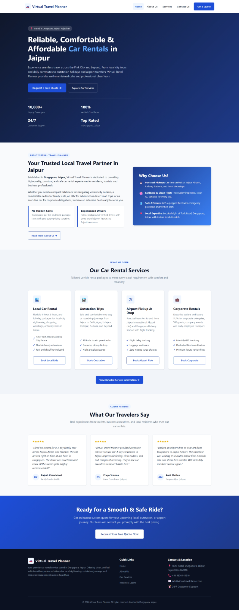
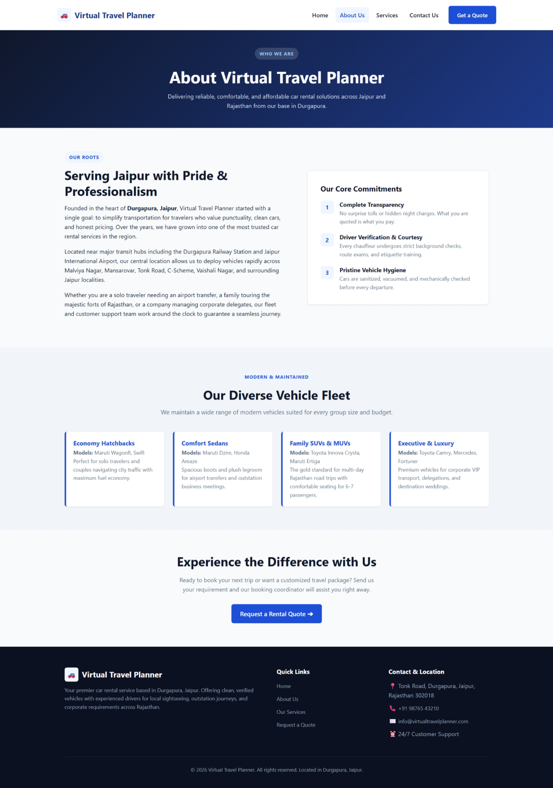
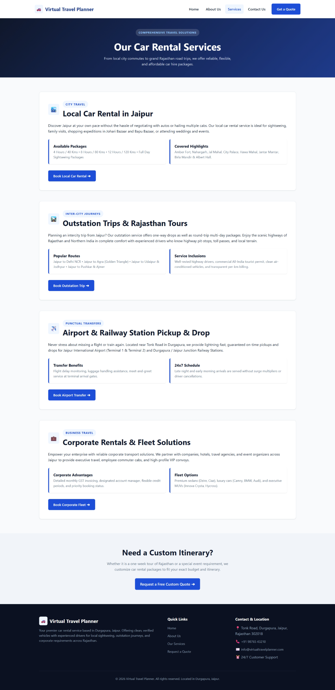
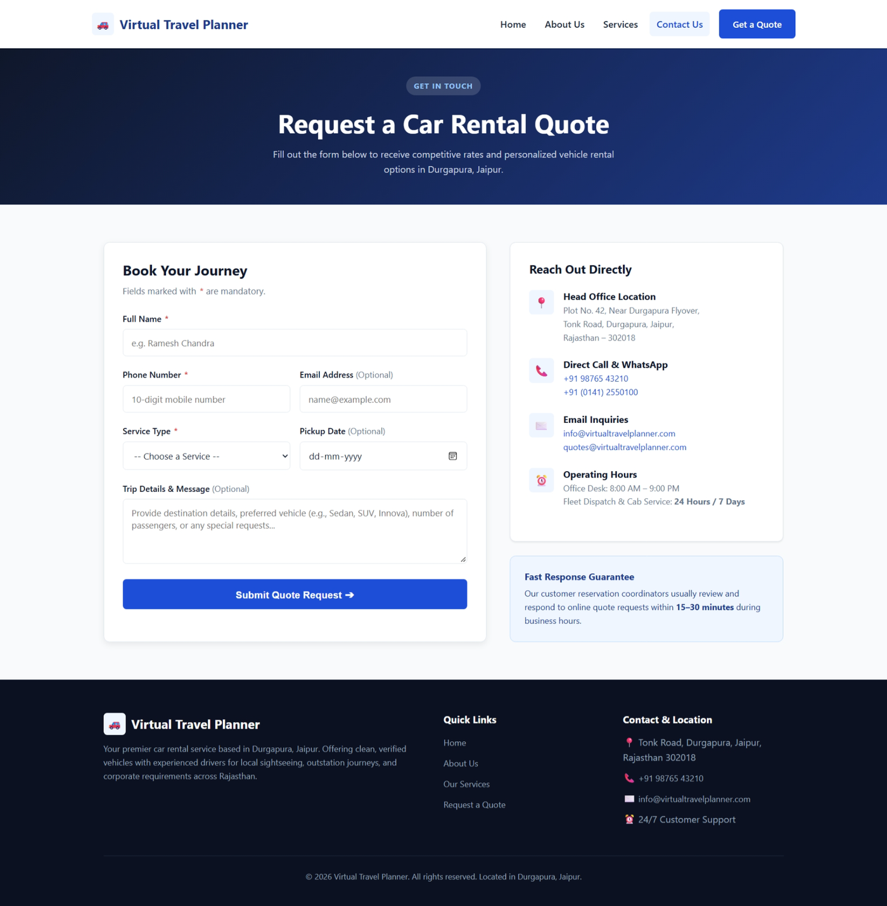

# Virtual Travel Planner — Car Rental Website

A responsive car-rental website for **Durgapura, Jaipur, Rajasthan**, built with Core PHP, MySQL, HTML5, CSS3, and vanilla JavaScript. It presents local rentals, outstation trips, airport and railway transfers, corporate travel, and a quote-request workflow.

## Screenshots

The screenshots below show the current UI across the main pages.

<details open>
<summary><strong>Home page</strong></summary>
<br>

</details>

<details>
<summary><strong>About page</strong></summary>
<br>

</details>

<details>
<summary><strong>Services page</strong></summary>
<br>

</details>

<details>
<summary><strong>Contact and quote request page</strong></summary>
<br>

</details>

## Features

- Responsive layout for desktop, tablet, and mobile.
- Separate pages for local rentals, outstation trips, airport/railway transfers, corporate rentals, and enquiries.
- Quote request form with server-side validation and user feedback.
- PDO prepared statements for database operations.
- Post-Redirect-Get (PRG) pattern to help prevent duplicate form submissions.
- Environment-based database settings loaded from `.env`.
- Automated test runner for quote submission validation and database handling.
- Vanilla CSS and JavaScript; no frontend framework required.

## Tech Stack

- **Backend:** Core PHP
- **Database:** MySQL / MariaDB, PDO
- **Frontend:** HTML5, CSS3, vanilla JavaScript
- **Local environment:** XAMPP, WAMP, LAMP, or PHP's built-in server

## Project Structure

```text
virtual-travel-planner/
├── assets/
│   ├── css/style.css
│   ├── js/main.js
│   └── images/
│       ├── virtual-travel-planner-home.png
│       ├── virtual-travel-planner-about.png
│       ├── virtual-travel-planner-services.png
│       └── virtual-travel-planner-contact.png
├── config/db.php
├── includes/
│   ├── header.php
│   └── footer.php
├── sql/schema.sql
├── tests/test_quote_submission.php
├── about.php
├── contact.php
├── index.php
├── services.php
├── submit_quote.php
├── .env.example
└── README.md
```

## Run Locally (XAMPP)

### 1. Clone into the web root

```powershell
cd C:\xampp\htdocs
git clone https://github.com/rahuldevligri/virtual-travel-planner.git
cd virtual-travel-planner
```

For WAMP, place the project under `C:\wamp64\www`.

### 2. Configure environment variables

Copy the example configuration to a local `.env` file:

```powershell
Copy-Item .env.example .env
```

Edit `.env` and set your local database values. Typical local XAMPP defaults are:

```dotenv
DB_HOST=127.0.0.1
DB_PORT=3306
DB_NAME=virtual_travel_planner
DB_USER=root
DB_PASS=
```

Keep `.env` local. Do not commit database passwords or production credentials.

### 3. Start Apache and MySQL

Open the XAMPP Control Panel and start **Apache** and **MySQL**.

### 4. Import the database schema

Import `sql/schema.sql` through phpMyAdmin, or run:

```bash
mysql -u root -p < sql/schema.sql
```

### 5. Open the site

Visit:

```text
http://localhost/virtual-travel-planner/
```

## Run Tests

A standalone test runner is included:

```bash
php tests/test_quote_submission.php
```

Start MySQL and import `sql/schema.sql` first. The test runner covers required-field validation, phone and email validation, allowed service types, valid request insertion, and parameterized input handling.

## Security Notes

- `config/db.php` reads database settings from `.env`.
- Use PDO prepared statements for user-supplied SQL values.
- Escape untrusted values rendered into HTML.
- Keep `.env` out of version control; commit only `.env.example`.
- Before production deployment, configure HTTPS, production environment variables, least-privilege database access, and safe server-side error handling.

## License

No license file is currently included. Add a `LICENSE` file if you want to grant explicit permission for others to reuse, modify, or distribute the code.
